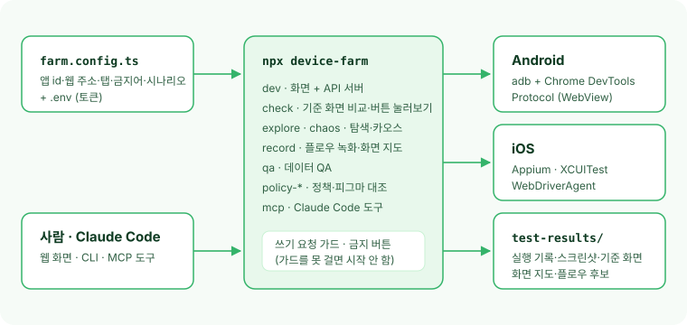

# @ahnseungchan/device-farm (한국어)

[English](https://github.com/Ahnseungc/device-farm/blob/main/README.md)

**WebView로 만든 모바일 앱을 실기기에서 QA 자동화하는 디바이스팜.**
내 프로젝트에 설치하고 `farm.config.ts` 하나로 점검할 앱을 정합니다.

<p align="center">
  <a href="https://ahnseungc.github.io/device-farm/"></a>
</p>

<p align="center">
  <b><a href="https://ahnseungc.github.io/device-farm/">라이브 데모 →</a></b> (서버·기기 없이 가상 앱 「Sample Shop」 데이터로 화면만 봅니다. 읽기 전용)
</p>

<p align="center">
  
</p>

점검할 앱은 코드에 없습니다. 패키지 id·웹 주소·하단 탭·금지어·시나리오처럼 앱마다 다른 값은 전부 `farm.config.ts`로 **주입**합니다.
Android는 adb + Chrome DevTools Protocol(Playwright), iOS는 Appium(XCUITest·WebDriverAgent)으로 앱 안 WebView를 직접 조작합니다.

## Features

- **빌드 점검**: 새 빌드 감시 → 설치 → 고정 주소 화면 점검. 앱 오류 문구·로그인 튕김·빈 화면·기준 화면 픽셀 비교로 판정.
- **버튼 눌러보기·화면 지도**: 버튼별 반응을 기록하고 화면 간 이동을 지도로 쌓는다. 지도 블록을 이어 붙여 플로우를 만든다.
- **플로우**: 홈에서 버튼·링크만 눌러 가는 시나리오. 녹화, 화면 지도 조립, PRD로 LLM 후보 생성(선택).
- **데이터 QA**: 화면이 부르는 GET API를 다시 불러 합계·표시 값을 규칙으로 맞춰 본다(LLM 없음).
- **탐색·카오스 탐색**: 너비 우선 탐색과 시드 고정 카오스(뒤로·연타·로딩 중 뒤로·백그라운드·재시작).
- **정책·피그마 대조**: Confluence 정책 바뀜 감지, 규칙 뽑기, 피그마 문구 대조.
- **원격 조작**: 웹 화면에서 기기 화면을 보며(Android H.264, iOS MJPEG) 직접 누른다. 조작 중인 기기는 잠근다.
- **Claude Code MCP**: Claude가 MCP 도구로 기기를 탐색하고, 찾은 경로를 플로우 후보로 올린다.

## 설치

```bash
npm install -D @ahnseungchan/device-farm
```

| 준비물                                                                     | 언제 필요                  |
| -------------------------------------------------------------------------- | -------------------------- |
| macOS, Node.js 22 이상                                                     | 항상                       |
| `adb`(Android platform-tools), USB 디버깅을 켠 기기                        | Android                    |
| WebView 디버깅을 켠 dev 빌드: `WebView.setWebContentsDebuggingEnabled(true)` | Android                    |
| Xcode, Appium + XCUITest 드라이버(WebDriverAgent), `isInspectable = true`인 빌드 | iOS                  |
| Firebase 서비스 계정, App Store Connect API 키                             | 새 빌드 자동 받기(선택)    |
| Confluence API 토큰, Figma 토큰                                            | 정책·피그마 대조(선택)     |

호스트 맥·기기 준비: [docs/operations.md](https://github.com/Ahnseungc/device-farm/blob/main/docs/operations.md)

<details>
<summary><b>점검할 앱이 맞춰야 할 것</b></summary>

1. **WebView 디버깅**이 켜진 빌드. 디바이스팜은 이 디버깅 소켓으로 들어간다.
2. **경로형 딥링크**: `<scheme>://<웹 경로>`를 받으면 그 웹 경로를 WebView로 연다.
3. **하단 탭이 웹 링크**(`a[href]` 또는 `role=link`)이고, 화면 상단 뒤로 버튼에 이름(`aria-label`)이 있다.
4. 점검용 계정으로 로그인해 둔다. 로그인 화면으로 튕기면 「로그인 필요」로 남는다.

</details>

## Quick start

```bash
npx device-farm init   # farm.config.ts, .env.example 생성(이미 있으면 건너뜀)
npx device-farm dev    # http://127.0.0.1:5173 (--port 로 변경)
```

`init`이 만든 `farm.config.ts`를 내 앱 값으로 고칩니다. 필수 값만 남기면 이 정도입니다.

```ts
// farm.config.ts
import { defineAppConfig } from "@ahnseungchan/device-farm";

export default defineAppConfig({
  name: "My App",
  appIds: { dev: "com.example.app.dev", prod: "com.example.app" },
  web: { dev: "https://dev.app.example.com", prod: "https://app.example.com" },
  homePath: "/home",
  homeTabName: "홈",
  tabPaths: { 검색: "/search", 마이: "/my" },
  deepLink: { scheme: "myapp", homeHost: "home" },
});
```

토큰이 필요하면 `.env.example`을 `.env`로 복사해 채우고, `.gitignore`에 `.env`와 `test-results/`를 넣어 두세요.
결과(실행 기록·스크린샷·기준 화면·화면 지도)는 전부 작업 폴더의 `test-results/`에 쌓입니다.

<details>
<summary><b>데이터 QA 규칙 예시</b></summary>

```ts
import { defineAppConfig, equalWon, formatWon, numberAt, textHas } from "@ahnseungchan/device-farm";

export default defineAppConfig({
  // ...필수 값
  apiOrigin: "https://api-dev.app.example.com",
  qa: {
    sessionPath: "/api/auth/session",
    screens: [
      {
        path: "/cart",
        name: "장바구니",
        apis: { cart: "/v1/users/{userId}/cart" },
        rules: [
          {
            id: "total-shown",
            title: "받은 합계가 화면에 그대로 보인다",
            check: (context) => {
              const shown = `${formatWon(numberAt(context, "cart", "totalWon"))}원`;
              return textHas(context.text, shown) ? null : `화면에 없음: 합계 「${shown}」`;
            },
          },
        ],
      },
    ],
  },
});
```

`npx device-farm qa --device <id> [--path /cart]`로 돌립니다. 전체 예시는 `init`이 만든 `farm.config.ts`에 있습니다.

</details>

## 앱 설정

`defineAppConfig()`가 빠진 값을 기본값으로 채웁니다. 타입은 `AppConfigInput`·`AppConfig`로 패키지에서 가져올 수 있습니다.
설정 파일은 `FARM_CONFIG` → 작업 폴더 `farm.config.ts` → `farm.config.example.ts` 순으로 찾고, 비밀 값은 작업 폴더 `.env`에서 읽습니다.

| 필드                                 | 필수 | 설명                                                                         |
| ------------------------------------ | ---- | ---------------------------------------------------------------------------- |
| `name`                               | ✓    | 앱 이름. 화면 제목·프롬프트에 쓴다                                           |
| `appIds`                             | ✓    | `{ dev, prod }` Android 패키지 = iOS 번들 id. 다르면 `iosBundleIds`          |
| `homePath`·`homeTabName`·`tabPaths`  | ✓    | 홈 경로, 홈 탭 이름, 하단 탭 이름 → 경로                                     |
| `web`                                |      | `{ dev, prod }` WebView 웹 주소. 비면 `FARM_WEB_ORIGIN_DEV`·`FARM_WEB_ORIGIN_PROD` |
| `apiOrigin`                          |      | API 호스트(웹과 다를 때). 가드가 내부로 보고 데이터 QA가 부른다              |
| `deepLink`                           |      | `{ scheme, homeHost }` 경로형 딥링크                                         |
| `guard`                              |      | 기본 금지어·금지 API에 **더할** 값, 늘 통과시킬 `pushTokenRequests`          |
| `scenarios`·`excludedScenarioPaths`  |      | 고정 주소 화면 점검 목록과 뺄 경로                                           |

<details>
<summary><b>전체 필드</b></summary>

| 필드                        | 설명                                                                                                                                                                           |
| --------------------------- | ------------------------------------------------------------------------------------------------------------------------------------------------------------------------------ |
| `inPageBackNames`           | 화면 상단 뒤로 버튼 이름. 기본 `["뒤로가기", "Back"]`                                                                                                                          |
| `loginPaths`·`appErrorText` | 로그인 화면 경로, 앱 오류 문구. 기본 `["/login"]`, `"Application error"`                                                                                                        |
| `android.mainActivity`      | WebView 액티비티. 다른 네이티브 화면이 위에 있으면 뒤로 키로 닫는다                                                                                                            |
| `webview`                   | `stackResetScript`(WebView 스택 닫기 브리지), `sheetCloseName`(시트 닫기 버튼)                                                                                                 |
| `guard`                     | `extraForbiddenButtonWords`·`extraForbiddenClickNames`·`extraForbiddenApiPatterns`, `pushTokenRequests`, 누르지 않을 `avoidedNamePattern`·`noPressPathPattern`                  |
| `qa`                        | `{ screens, sessionPath }` 데이터 QA 화면·규칙, 로그인 세션 경로                                                                                                               |
| `policy.confluence`         | `{ cloudId, spaceKey, titleQuery, siteUrl }` 정책 정본                                                                                                                         |
| `figma`                     | `{ frontRepo, ref, appDir }` 화면 → 피그마 노드를 뽑을 프론트 체크아웃                                                                                                         |
| `install`                   | `sources`(플랫폼·빌드별 `firebase`/`testflight`), `firebase`(앱 id), `testflightDevAppName`                                                                                    |
| `ios`                       | `{ teamId, wdaBundleId }` WDA 서명. 비면 `IOS_TEAM_ID`·`IOS_WDA_BUNDLE_ID`                                                                                                     |
| `access.allowedDomains`     | 화면에 들어올 수 있는 Tailscale 계정 도메인. 비면 이 맥에서만                                                                                                                  |

데이터 QA 도우미 `equalWon`·`formatWon`·`numberAt`·`textHas`·`pick`도 패키지 루트에서 내보냅니다. 환경 변수 목록은 `.env.example`에 있습니다.

</details>

## CLI

모든 명령은 작업 폴더(내 프로젝트) 기준으로 설정·`.env`를 읽고 결과를 씁니다. `npx device-farm <명령> --help`로 옵션을 볼 수 있습니다.

| 명령                                      | 하는 일                                                               |
| ----------------------------------------- | --------------------------------------------------------------------- |
| `device-farm init`                        | `farm.config.ts`·`.env.example` 생성                                  |
| `device-farm dev [--port 5173]`           | 화면 + API 서버(127.0.0.1). 새 빌드 감시·정책 감시가 함께 돈다         |
| `device-farm check --build dev\|prod --version 2.1.5` | 떠 있는 서버에 빌드 점검을 시키고 끝날 때까지 진행을 출력 |
| `device-farm explore`                     | 탐색 점검(서버 필요)                                                  |
| `device-farm chaos --device <serial>`     | 카오스 탐색(Android dev)                                              |
| `device-farm record --device <serial>`    | 사람 조작 녹화 → 화면 지도·플로우 후보                                |
| `device-farm qa --device <id>`            | 데이터 QA만                                                           |
| `device-farm policy-watch`                | 정책 바뀜 감지·규칙 뽑기·피그마 문구                                  |
| `device-farm policy-check --device <id>`  | 정책·피그마 대조를 기기 한 대에서                                     |
| `device-farm explore-allowlist`           | OpenAPI(`FARM_OPENAPI_URL`)의 쓰기 API를 허용 목록에 deny로 추가      |
| `device-farm mcp`                         | Claude Code용 MCP 서버(stdio)                                         |

<details>
<summary><b>명령별 옵션</b></summary>

```bash
device-farm dev [--port 5173]
device-farm check --build dev|prod --version 2.1.5 [--devices all|id,id] [--port 5173]
device-farm explore [--devices all|id,id] [--build dev] [--port 5173]
device-farm chaos --device <Android serial> [--seed 42] [--episodes 3] [--steps 50] [--minutes 60] [--no-guard]
device-farm record --device <Android serial> [--seconds 300] [--name "플로우 이름"]
device-farm qa --device <id> [--path /cart]
device-farm policy-watch [--extract <pageId>] [--figma]
device-farm policy-check --device <id> [--path /my/orders]
```

`check`·`explore`는 떠 있는 `dev` 서버에 작업을 시킵니다. 포트를 바꿨다면 같은 `--port`를 넘기세요.
탐색 허용 목록 `explore/allowlist.json`, 입력칸 테스트 값 `explore/form-values.json`, 정책 등록 `policy/sources.json`은 작업 폴더에 두고 커밋합니다. 허용 목록이 없으면 모든 쓰기 요청을 막습니다.

</details>

## Claude Code (MCP)

```bash
# 내 프로젝트 폴더에서
claude mcp add --scope project device-farm -- npx device-farm mcp
```

- 도구 흐름: `device_start` → `device_look` / `device_press` / `device_go_home` / `device_report_issue` → `device_finish`.
- 끝나면 화면 지도에 합치고, 홈부터 다시 돌 수 있는 경로면 플로우 후보로 올린다. 보고서는 `test-results/agent/<시각>/report.json`.
- 탐색은 Android dev 빌드에서 쓰기 요청 가드를 켠 채로만 돈다. 사용자의 Claude Code 계정으로 돌고 API 키는 필요 없다.

이 저장소는 Claude Code 플러그인(`.claude-plugin`, `skills/run-check`·`chaos-explore`·`policy-figma-check`)으로도 쓸 수 있습니다. 저장소를 받아 `npm install`한 뒤 플러그인으로 추가하세요.

## 안전

- 탐색·버튼 눌러보기·카오스·MCP 탐색은 **Android dev 빌드**에서, 쓰기 요청 가드를 켠 채로 돈다. 가드를 못 걸면 시작하지 않는다(fail closed).
- 가드 판단 순서: 읽기(GET·HEAD·OPTIONS) 통과 → `pushTokenRequests` 통과 → 금지 경로 차단 → 허용 목록 allow 통과 → deny·모름 차단.
- 기본 금지 버튼(구매·결제·매도·매수·송금·출금·탈퇴·주문·환불·해지·삭제·로그아웃 등)은 목록에서 빠지고, 눌러도 거절한다. 앱 설정은 금지어를 더할 뿐 빼지 못한다. 비밀번호·PIN 화면은 누르지 않고 나가기만 한다.
- `chaos --no-guard`는 쓰기 요청을 막지 않는다. **dev 서버에서만** 쓴다. 금지 버튼은 그대로 누르지 않는다.
- 화면 서버는 127.0.0.1에만 열린다. 밖에서는 `tailscale serve`로만 들어오고, `access.allowedDomains`로 계정 도메인을 제한한다.

## FAQ

<details>
<summary><b>기기 없이 화면만 열어 볼 수 있나요?</b></summary>

네. `npx device-farm init && npx device-farm dev`면 예시 설정으로 화면이 열립니다. 기기 목록은 비어 있고 점검은 돌지 않습니다.
가짜 데이터로 채운 화면은 [라이브 데모](https://ahnseungc.github.io/device-farm/)에서 바로 볼 수 있습니다.

</details>

<details>
<summary><b>iOS도 탐색·카오스가 되나요?</b></summary>

빌드 점검·원격 조작은 iOS(Appium)를 지원합니다. 탐색·카오스·녹화·MCP 탐색은 지금 Android dev 빌드만 지원합니다.

</details>

<details>
<summary><b><code>check</code>가 서버에 연결할 수 없다고 합니다.</b></summary>

`check`·`explore`는 떠 있는 `device-farm dev` 서버에 작업을 시킵니다. 다른 터미널에서 `dev`를 먼저 켜고, 포트를 바꿨다면 같은 `--port`를 넘기세요.

</details>

<details>
<summary><b>LLM 키가 꼭 필요한가요?</b></summary>

아니요. 점검·탐색·카오스·데이터 QA는 규칙으로만 판정합니다. PRD로 플로우 후보를 만들 때(`FLOW_LLM_*`)와 정책 판정에만 씁니다.

</details>

## 문서

- [운영: 호스트 맥과 기기 준비](https://github.com/Ahnseungc/device-farm/blob/main/docs/operations.md)
- [설계: 빌드 점검·기준 화면·플로우·화면 지도](https://github.com/Ahnseungc/device-farm/blob/main/docs/design-device-farm.md)
- [설계: 탐색 점검과 쓰기 요청 가드](https://github.com/Ahnseungc/device-farm/blob/main/docs/design-explore.md)
- [설계: 카오스 탐색](https://github.com/Ahnseungc/device-farm/blob/main/docs/design-chaos.md)
- [설계: 정책·피그마 대조](https://github.com/Ahnseungc/device-farm/blob/main/docs/design-policy-figma.md)

## Contributing

이슈와 PR 환영합니다. 재현 방법이 있는 버그 리포트, 문서 보완 모두 도움이 됩니다.

```bash
git clone https://github.com/Ahnseungc/device-farm.git && cd device-farm
npm install
npm run typecheck && npm test && npm run build
npm run dev        # 화면 개발(vite dev). 저장소 루트 farm.config.ts → farm.config.example.ts
npm run demo:dev   # 데모 화면(서버·기기 없음) http://127.0.0.1:5499
```

데모(`apps/web/demo/`)는 `./api-client`·`./live-view`만 가짜 데이터 모듈로 바꿔 끼워 같은 화면 코드를 씁니다. 실제 빌드에는 들어가지 않습니다.
`npm run demo:build && npx tsx tools/record-demo-gif.ts`로 `docs/assets/demo.gif`를 다시 만듭니다(ffmpeg 필요). `main`에 push하면 `.github/workflows/pages.yml`이 데모를 GitHub Pages에 올립니다.

npm workspaces 모노레포입니다. 의존 방향은 `core ← devices ← engine ← server ← apps`이고 `tools/boundaries.test.ts`가 지킵니다. 배포 패키지는 워크스페이스를 `dist/`에 묶어 냅니다(tsup + vite build).

릴리스: `package.json`·`CHANGELOG.md`의 버전을 올리고 `npm run publish:npm`(`prepublishOnly`가 typecheck·test·build를 돈다), `v<version>` 태그를 push합니다.

## License

[MIT](https://github.com/Ahnseungc/device-farm/blob/main/LICENSE)
